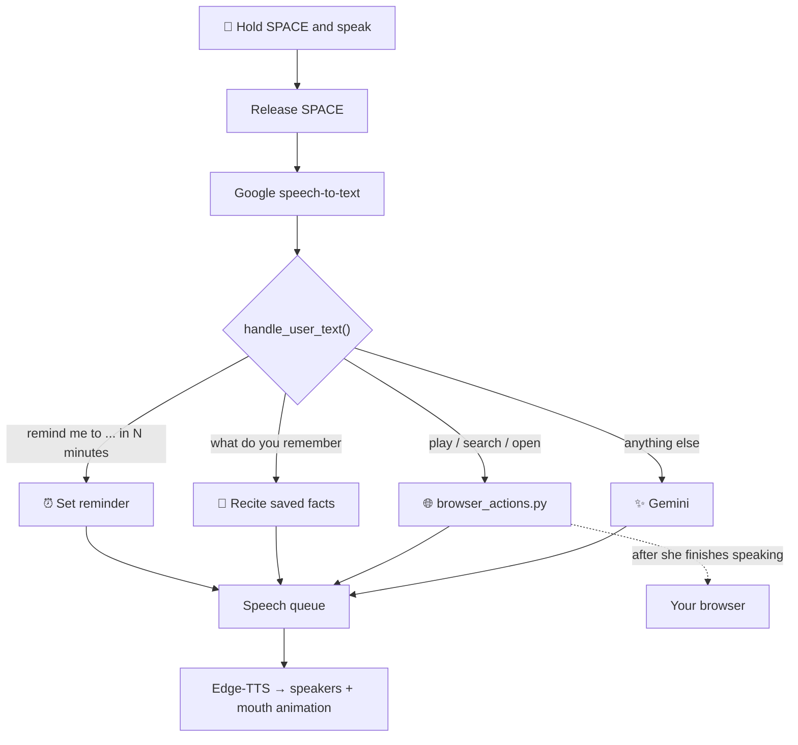

# 🤖 Denise - AI Desktop Companion Robot


> A cute, expressive, AI-powered desktop companion robot that lives on your Windows desktop. Hold **Space** and talk to her: she answers in a natural voice, remembers facts about you, sets reminders, and can open the browser to search the web or **play a video on YouTube** when you ask. She blinks, looks around, yawns and falls asleep like a tiny living thing.

Created by **Yasindu Sasmitha** | Version 1.1

---

## 🆕 What's New in 1.1

- 🎤 **Real push-to-talk** - Denise now records *while* you hold Space and sends it when you let go (before, recording only started after you released the key).
- 🗣️ **Speech queue** - replies, reminders and giggles are spoken one after another. Nothing talks over anything else, and nothing important gets dropped.
- 🎲 **Natural timing** - blinks, look-arounds and yawns now really happen at random moments instead of at an almost fixed rhythm.
- 🌐 **Browser & YouTube voice commands** - "play lofi on YouTube", "search for python tutorials", "open YouTube".
- 📚 **Docs match the code** - features that are not built yet (weather, system monitor, transparent window) moved to the **Roadmap**.

---

## ✨ Features

### 🎭 Lifelike Expressions
- Blinking at random moments (every 3-8 seconds)
- Eye tracking that follows your cursor
- Random look-around when you're idle (like Vector / Emo robots)
- Gets bored after 30 seconds, yawns every 45-90 seconds, and falls asleep after 60 seconds of inactivity
- Wakes up when you click or press a key
- Emotional reactions: Happy, Surprised, Bored, Sleepy, Thinking, Listening, Clicked

### 🗣️ Natural Voice Interaction
- **Hold Space to talk**, release to send
- Speech-to-text with Google's free recognition API (via `SpeechRecognition`)
- Natural voice output with Microsoft Edge-TTS (no robotic monotone!)
- Mouth animation while she speaks
- A speech queue, so lines never overlap or get lost

### 🧠 AI Brain (Google Gemini)
- Powered by Google Gemini (currently `gemini-3.1-flash-lite`, easy to change)
- Short-term memory: the last few exchanges are sent along with each message (kept in RAM, resets when she restarts)
- Long-term memory: facts about you are saved in `user_facts.json`
- Custom personality: playful, curious, empathetic companion

### 🌐 Browser & YouTube Control
- **Play a video:** "Play Despacito on YouTube" or just "play lofi beats"
- **Search YouTube:** "Search YouTube for guitar lessons"
- **Search the web:** "Search for python tutorials" or "Google how to tie a tie"
- **Open a site:** "Open YouTube" (also Google, Gmail, GitHub, the browser)
- She tells you what she's doing first, *then* opens the browser

### ⏰ Reminders
- Voice command: "Remind me to [task] in [X] minutes"
- She speaks the reminder out loud when the time comes, even if she is in the middle of a sentence

### 🖱️ Desktop Integration
- Borderless window you can drag anywhere (left-click and drag)
- Right-click reaction: the robot giggles when you click her

---

## 🎥 Demo

_Demo GIF coming soon!_

---

## 🚀 Getting Started

### Prerequisites

- **Windows 10/11** (uses Windows-specific APIs for dragging the window)
- **Python 3.10+** (tested on 3.13.2)
- A **microphone** for voice input
- An **internet connection** (Gemini, Edge-TTS, speech recognition and YouTube all need it)

### 1. Clone the Project

```bash
git clone https://github.com/Yasindu-Sasmitha/Denise.git
cd Denise
```

### 2. Create a Virtual Environment

```bash
python -m venv venv
venv\Scripts\activate
```

### 3. Install Dependencies

```bash
pip install -r requirements.txt
```

The requirements are:

| Package | Used for |
|---|---|
| `pygame` | The face, window and audio playback |
| `SpeechRecognition` + `pyaudio` | Microphone input and speech-to-text |
| `edge-tts` | Denise's voice |
| `google-genai` | Gemini AI brain |
| `requests` | YouTube video lookup |
| `python-dotenv` | Loading your `.env` file |
| `yt-dlp` *(optional)* | Playing YouTube videos without an API key |

> ⚠️ If PyAudio fails to install, try:
> ```bash
> pip install pipwin
> pipwin install pyaudio
> ```

### 4. Get API Keys

#### 🔑 Google Gemini API Key (Required)

1. Go to [Google AI Studio](https://aistudio.google.com/)
2. Click **Get API Key** → **Create API Key**
3. Copy the key and keep it safe.

#### 🔑 YouTube Data API Key (Optional)

Only needed so that "play X on YouTube" can open the top video directly. Without it, Denise tries `yt-dlp` (if installed), and otherwise opens the YouTube **results page** for you to click.

1. Open the [Google Cloud Console](https://console.cloud.google.com/) and create or pick a project
2. Enable **YouTube Data API v3**
3. Go to **Credentials** → **Create credentials** → **API key**
4. (Recommended) restrict the key to the YouTube Data API

### 5. Configure Environment Variables

Copy the template and fill in your keys:

```bash
copy .env.example .env
```

```env
GEMINI_API_KEY=your_gemini_api_key_here
YOUTUBE_API_KEY=your_youtube_api_key_here   # optional
```

> 🔒 `.env` is listed in `.gitignore`, so your keys are never committed.

### 6. Assets

The `assets/` folder is included in the repo. If you want to draw your own face, keep the same file names (transparent PNGs with matching dimensions):

```text
assets/
├── face_base.png          # Dark rounded face background
├── eyes_idle.png          # Default blue eyes
├── eyes_listening.png     # Yellow listening eyes
├── eyes_closed.png        # Closed eyes (for blinking)
├── eyes_think.png         # Thinking eyes
├── eyes_happy.png         # Happy sparkle eyes
├── eyes_surprised.png     # Surprised wide eyes
├── eyes_sleep.png         # Sleepy half-closed eyes
├── eyes_click.png         # Reaction eyes for clicking
├── mouth_talk_1.png       # Talking mouth frame 1
├── mouth_talk_2.png       # Talking mouth frame 2
├── mouth_yawn.png         # Yawning mouth
└── mouth_frown.png        # Bored frown
```

### 7. Run the Robot

```bash
python main.py
```

Run it **from the project folder** (the assets and the memory file are found relative to where you start it). Your robot should appear on screen! 🎉

Want to check your microphone first? Run `python mic_test.py`.

---

## 🎮 Controls

### Keyboard

| Key | Action |
|---|---|
| `SPACE` (hold) | Record your voice - release to send |
| `R` | Ask what the robot remembers about you |
| `H` | Trigger happy expression |
| `S` | Trigger surprised expression |
| `C` | Trigger click reaction |
| `ESC` | Close the robot |

### Mouse

| Button | Action |
|---|---|
| Left-click + drag | Move the robot window |
| Right-click | Click reaction (robot says "Hee heee!") |

---

## 🗣️ Voice Commands

Hold **SPACE**, say one of these, then release:

| Say | What happens |
|---|---|
| "Play Despacito on YouTube" / "Play lofi beats" | Finds the top video and opens it |
| "Search YouTube for guitar lessons" | Opens the YouTube results |
| "Search for python tutorials" / "Google how to tie a tie" | Opens a Google search |
| "Open YouTube" / "Open Google" / "Open Gmail" / "Open GitHub" / "Open the browser" | Opens that site |
| "Remind me to call John in 5 minutes" | Sets a reminder (minutes only) |
| "What do you remember about me?" | Recites the facts she has saved |
| Anything else | Chats with you via Gemini |

💡 **Tips**
- Polite lead-ins are fine: "Hey Denise, can you play some jazz please?" works. (This is just ignored politeness, **not** a wake word. You still hold Space.)
- Normal conversation is left alone: "let's play a game" or "search your memory" go to Gemini, not the browser.
- Tell her facts about yourself ("my name is ...", "my favourite colour is ...") and she'll save them to `user_facts.json`.

---

## 🗂️ Project Structure

```text
Denise/
│
├── main.py                 # The main application (face, voice, brain)
├── browser_actions.py      # Voice-controlled browser / YouTube commands
├── mic_test.py             # Quick microphone check
├── requirements.txt        # Python dependencies
├── .env.example            # Template for your API keys
├── .env                    # Your API keys (DO NOT commit!)
├── user_facts.json         # Auto-generated memory file (git-ignored)
├── LICENSE
├── README.md               # This file
│
└── assets/                 # PNG images for the face
    └── (13 files, see the Assets section)
```

---

## 🧠 How It Works

### Face Layers

```text
┌─────────────────────────────────────────────────────┐
│                    Pygame Window                    │
│  ┌───────────────┐                                  │
│  │  Base Face    │  ← face_base.png                 │
│  ├───────────────┤                                  │
│  │  Eyes Layer   │  ← Changes with her emotion      │
│  ├───────────────┤                                  │
│  │  Mouth Layer  │  ← Only when talking / yawning   │
│  └───────────────┘                                  │
└─────────────────────────────────────────────────────┘
```

### From your voice to her answer



Denise runs three things side by side so the face never freezes:

- **Main thread** - draws the face, blinking, eye tracking, idle behaviours, and checks reminders
- **Push-to-talk thread** - records while Space is held, transcribes, and routes the command
- **Speech thread** - takes lines from the speech queue and speaks them one at a time (cosmetic lines like the giggle are skipped if she's already busy; replies and reminders are never skipped)

### Emotion State Machine

| State | Trigger | Look |
|---|---|---|
| IDLE | Default | Blue eyes |
| LISTENING | Mic is recording (Space held) | Yellow eyes |
| THINKING | Waiting for Gemini / a lookup | Looking-up eyes |
| SPEAKING | Playing her voice | Animated mouth |
| HAPPY | `H` key | Sparkle eyes |
| SURPRISED | `S` key | Wide eyes |
| BORED | 30 s without interaction | Frown mouth |
| YAWN | Every 45-90 s while idle | Open mouth |
| SLEEPING | 60 s of inactivity | Sleepy eyes |
| CLICKED | Right-click / `C` | Special eyes |

---

## ⚙️ Customization

### 1. Change the Robot's Name or Personality

In `get_gemini_response()`, edit the `system_prompt`:

```python
system_prompt = f"""You are YOUR_NAME, a playful, curious desktop robot companion..."""
```

You can change the tone (playful, serious, sarcastic), response length, favourite topics and behaviour rules.

### 2. Change the Voice

In `_speech_worker()`, change the voice code:

```python
communicate = edge_tts.Communicate(text, "en-GB-RyanNeural", pitch="+25Hz")
```

| Voice Code | Description |
|---|---|
| `en-US-JennyNeural` | Natural female (US) |
| `en-US-GuyNeural` | Natural male (US) |
| `en-GB-SoniaNeural` | Friendly female (British) |
| `en-GB-RyanNeural` | Calm male (British) |
| `en-AU-NatashaNeural` | Cheerful female (Australian) - **current default** |
| `en-IN-NeerjaNeural` | Warm female (Indian) |

Run `edge-tts --list-voices` in the terminal to see all options.

### 3. Change the Gemini Model

In `get_gemini_response()`:

```python
model='gemini-3.1-flash-lite',
```

### 4. Adjust Sleep Time

In `update_idle_behaviors()`:

```python
if now - robot.sleep_timer > 60:  # Change 60 to your desired seconds
```

### 5. Adjust Blink / Look / Yawn Timing

The random delays are set where each event is scheduled (`RobotState.__init__`, `update_blink()` and `update_idle_behaviors()`):

```python
robot.next_blink = now + random.uniform(3, 8)    # seconds between blinks
robot.next_yawn  = now + random.uniform(45, 90)  # seconds between yawns
```

### 6. Tune Push-to-Talk

Near the top of the microphone section in `main.py`:

```python
MAX_RECORD_SECONDS = 15   # longest single recording
MIN_RECORD_SECONDS = 0.4  # shorter taps are ignored
```

### 7. Add Websites She Can Open

In `browser_actions.py`, add the site to `SITES` and `SITE_NAMES`, and add its name to the `_OPEN_SITE` pattern:

```python
SITES = {"youtube": "https://www.youtube.com", "reddit": "https://www.reddit.com", ...}
```

### 8. Adjust Eye Movement

In `update_cursor_tracking()`:

```python
robot.eye_target_x = max(-35, min(35, dx * 0.2))  # Adjust range and sensitivity
robot.eye_current_x += (robot.eye_target_x - robot.eye_current_x) * 0.06  # Adjust speed
```

---

## 🐛 Troubleshooting

### Console says "Too short - hold Space while you talk"
Recordings under 0.4 seconds are ignored. Press and **keep holding** Space while you speak, then release.

### Robot says "Could not understand audio"
- Speak louder and closer to the mic
- Check Windows microphone permissions: Settings → Privacy → Microphone
- Speech recognition needs an internet connection
- Test your mic with `python mic_test.py`

### PyAudio installation fails
```bash
pip install pipwin
pipwin install pyaudio
```

### Gemini returns errors
- Verify your `.env` has the correct `GEMINI_API_KEY`
- Check your internet connection
- Check that your API key hasn't been revoked in AI Studio
- If the error mentions the model, change the model name in `get_gemini_response()`

### She opens YouTube search results instead of playing a video
She couldn't look up a video. Either add a `YOUTUBE_API_KEY` to `.env`, or run `pip install yt-dlp`.

### `yt-dlp` stopped working
YouTube changes often. Update it with `pip install -U yt-dlp`.

### The video opens but doesn't start playing
Some browsers block autoplay with sound. Click the video once.

### No voice / "TTS Error" in the console
Edge-TTS needs an internet connection. Check your connection and speakers.

### "Missing assets!" on the face
Run `python main.py` from the project folder and make sure all 13 PNGs are in `assets/`.

### Robot is not sleeping
- Make sure nothing keeps resetting `sleep_timer` (see the BORED/YAWN exclusion in the main loop)
- Lower the sleep threshold for testing (set it to 10 seconds)

---

## 🔒 Privacy

- 🎤 Your voice recording is sent to **Google's speech recognition** service to be turned into text
- 💬 What you say, plus the facts she has saved about you, is sent to **Google Gemini** to write her answers
- 🌐 Browser commands only open addresses built from fixed templates, with your words safely encoded, so a misheard phrase can't send her to a random site
- 🔑 API keys live in `.env` (never committed) and are never printed in error messages
- 🧠 `user_facts.json` stays on your computer and is git-ignored

---

## 🛣️ Roadmap

**Done**
- [x] True hold-to-talk push-to-talk
- [x] Speech queue (no overlapping or dropped speech)
- [x] Natural random blink / look / yawn timing
- [x] Web search, YouTube search and "play on YouTube" by voice

**Planned**
- [ ] Transparent background and always-on-top window (floats over your wallpaper)
- [ ] Live weather by voice ("What's the weather in Tokyo?")
- [ ] System monitoring (CPU, RAM, disk) with a high-CPU warning
- [ ] Wake word ("Hey Denise" instead of holding Space)
- [ ] Media controls by voice (pause, next, volume)
- [ ] Gemini picks her emotion for each reply (eyes react to what she says)
- [ ] Reminders that survive restarts, plus "at 3 PM" and hours
- [ ] Persistent chat history and a "forget ..." command
- [ ] Offline voice fallback when there is no internet
- [ ] Click-through mode (interact with apps behind the robot)
- [ ] System tray icon with mute / quit
- [ ] Document reader (PDF, DOCX, TXT → AI summaries)
- [ ] Vision mode (webcam input for Gemini multimodal)
- [ ] Multi-language support (including Sinhala)
- [ ] Custom sprite themes (change robot appearance)
- [ ] Daily greetings based on time of day
- [ ] A physical desk-robot version

### Known Limitations
- Windows only (window dragging uses Windows APIs)
- The window is borderless but **not** transparent or always-on-top yet
- Reminders work in minutes only and are lost if you close her
- Chat history is kept in memory only; only the saved facts survive a restart
- She is started from the project folder (assets and memory file are found relative to it)

---

## 🤝 Contributing

Contributions, bug reports, and feature requests are welcome! Feel free to:

1. Fork this project
2. Create a feature branch
3. Submit a pull request

---

## 📜 License

This project is licensed under the MIT License - see the [LICENSE](LICENSE) file for details.

---

## 🙏 Credits & Acknowledgments

- **Inspiration:** Anki Vector, Emo (Living AI), and Cozmo
- **AI:** Google Gemini
- **Voice:** Microsoft Edge TTS
- **Graphics Engine:** Pygame
- **Speech Recognition:** SpeechRecognition
- **YouTube lookup (optional):** YouTube Data API v3 and yt-dlp

---

## 📞 Contact

**Yasindu** - Project Creator

- GitHub: [@Yasindu-Sasmitha](https://github.com/Yasindu-Sasmitha)
- Email: yasindusasmitha@gmail.com

<p align="center"> <strong>⭐ If you enjoyed this project, give it a star! ⭐</strong><br> <em>Built with ❤️, Python, and a lot of curiosity.</em> </p>
